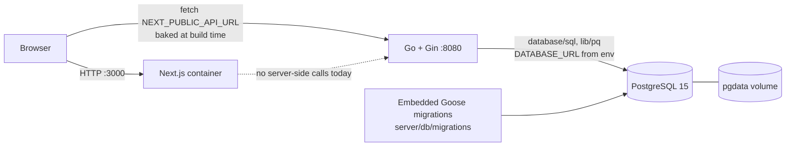
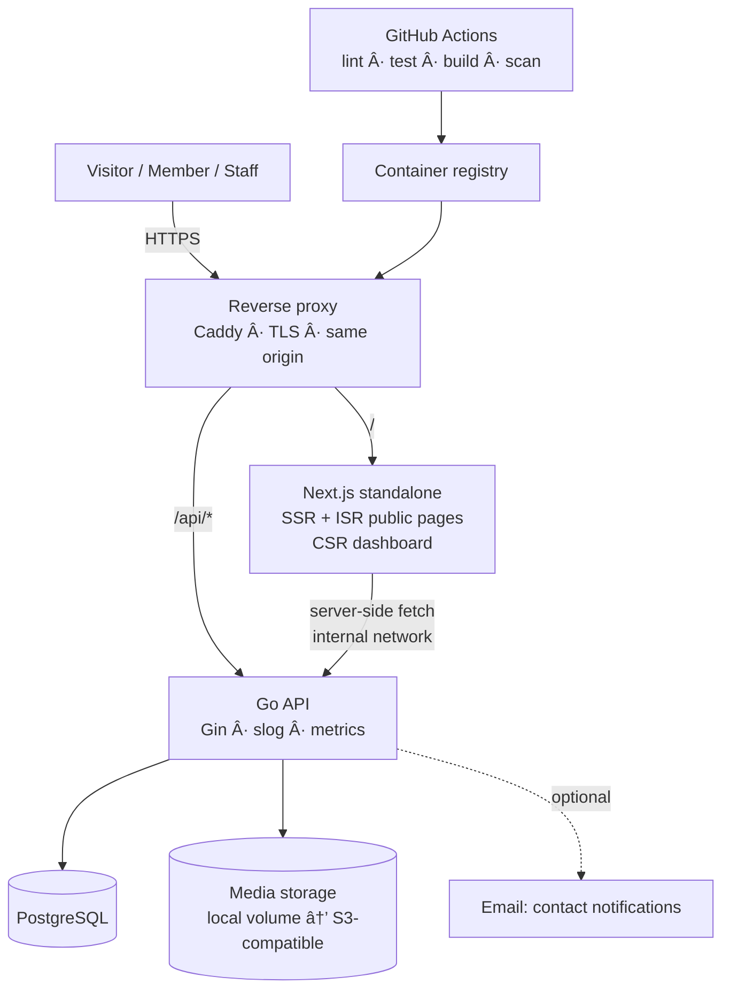
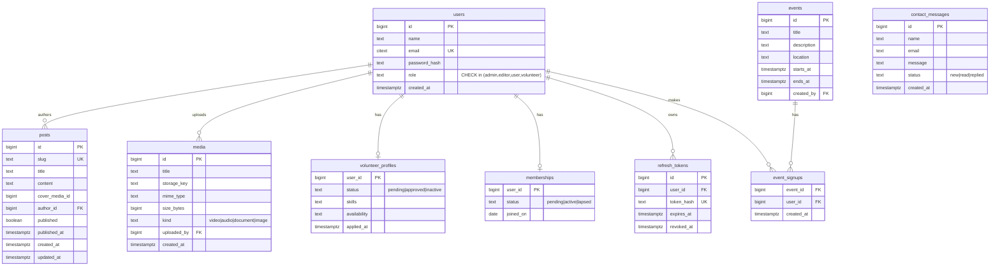

# ARCHITECTURE.md

Two views: **Current** (what the code does today) and **Target** (what the roadmap builds). The project is a community NGO site and staff workspace. Agents must keep this file in sync with the code.

## Runtime configuration

The process loads and validates environment settings once into `internal/config.Config` before opening the database. Invalid settings are reported together and stop startup. `TRUSTED_PROXIES` is an optional comma-separated list; it is empty by default.

| Setting | Default / validation | Purpose |
|---|---|---|
| `PORT` | `8080`; 1–65535 | HTTP listen port |
| `APP_ENV` | `development` | Cookie and Gin mode; `production` enables release mode |
| `DATABASE_URL` | required | PostgreSQL connection string |
| `JWT_SECRET` | required; at least 32 bytes | Signs access tokens |
| `CORS_ORIGINS` | empty | Comma-separated allowed origins |
| `UPLOAD_DIR` | `/data/uploads` | Uploaded media storage |
| `UPLOAD_MAX_BYTES` | 10 MiB; positive integer | Maximum uploaded file size |
| `DB_CONNECT_RETRIES` | `8`; positive integer | Database connection retry count |
| `MIGRATE_ON_START` | `false` in the binary; Compose sets `true` | Apply embedded migrations before serving |
| `ADMIN_EMAIL`, `ADMIN_PASSWORD` | both optional; set together, password at least 12 characters | First-admin bootstrap |
| `TRUSTED_PROXIES` | empty | Explicit Gin trusted proxy CIDRs or addresses |

The HTTP server uses bounded read/write/idle timeouts and graceful SIGINT/SIGTERM shutdown. `/healthz` is liveness and does not query PostgreSQL; `/readyz` and the `/health` alias check PostgreSQL with a two-second deadline. The container healthchecks use `/readyz`.

## 1. Current state



### Current API (all under `/api`)

| Method | Path | Auth | Notes |
|--------|------|------|-------|
| POST | `/register` | none | role forced to `user`; validates name, email, password |
| POST | `/login` | none | sets access + refresh cookies; access 15 min, refresh 7 d |
| POST | `/refresh` · `/logout` | refresh cookie / none | rotates or revokes refresh session |
| POST | `/contact` | none | validates and stores row; IP limited |
| GET | `/posts` · `/events` | none | published posts only; events currently unpaginated |
| GET | `/admin/posts` · `/admin/events` | admin | staff CRUD and publish controls |
| GET/POST/DELETE | `/admin/media` | admin | list, upload, delete |
| GET/POST/PATCH/DELETE | `/admin/users` | admin | user CRUD |
| GET/POST/PATCH/DELETE | `/editor/posts` · `/editor/events` · `/editor/media` | editor/admin | editor content and media routes |
| GET | `/me` · `/profile` | any user | authenticated profile reads |
| PUT | `/profile` | any user | updates name/email and optionally password |
| GET | `/healthz` | none | liveness; no database call |
| GET | `/readyz` · `/health` | none | readiness; checks database connectivity |

Auth, refresh-token, profile, admin user, post, event, media, contact, and volunteer handlers use generated sqlc queries with request contexts and injected dependencies. Handler and middleware database access no longer uses package-level database globals. No pagination is implemented. User and media CRUD exist; volunteers currently have contribution endpoints rather than application management.

### Current data model

`users(id, name, email, password, role, created_at, updated_at)` with a unique lower(email) index · `posts(id, title, content, author_id→users, published, created_at, updated_at)` · `events(id, title, description, event_date, created_at)` · `media(id, title, file_path, media_type, original_name, size_bytes, uploaded_by→users, created_at)` · `contacts(id, name, email, message, created_at)` · `refresh_tokens(id, user_id, token_hash, expires_at, revoked_at)` · `volunteer_contributions(...)`

### Migration and sqlc workflow

- The canonical Goose SQL migrations live in `server/db/migrations/`; `server/db/migrations_embed.go` embeds them into the API binary. The migration directory contains SQL files only. Schema migrations contain no sample rows. Dev sample rows live in `server/db/seed/dev.sql` and load only through the `seed` Compose profile.
- `MIGRATE_ON_START=true` makes the API create a Goose provider and apply pending migrations before bootstrapping the admin or serving requests. The provider uses a PostgreSQL session advisory lock so concurrent API starts serialize. Development Compose sets this to true by default; set it explicitly in `.env` for other environments.
- Tool versions are pinned in `server/go.mod` using Go's `tool` directive: `go tool sqlc` v1.29.0 and `go tool goose` v3.24.3. Generate with `make sqlc`; enforce generated-code parity with `make sqlc-check` (`go tool sqlc diff`).
- `sqlc.yaml` reads schema from `server/db/migrations` and query sources from `server/db/query`. Generated code is committed under `server/dbgen`. All handler and middleware queries use the existing injected `*dbgen.Queries`; handlers use `*sql.DB` only where transactions are needed. Refresh rotation uses `WithTx` and locks the active token row with `SELECT ... FOR UPDATE`. PostgreSQL NUMERIC volunteer hours are generated as strings by sqlc; handlers pass decimal text to writes and convert the aggregate to the existing numeric JSON field.
- `DATABASE_URL_TEST` enables real-Postgres integration tests. Tests create an isolated temporary schema and cover migration up/down/up, BootstrapAdmin idempotence, auth/user/session flows including concurrent refresh, duplicate emails, admin guards, and role re-checks, post/event behavior including draft visibility, author ownership, role authorization, missing IDs, and event validation, and B3 behavior including contact rate limiting, media/file cleanup, volunteer NUMERIC hours, and route-role authorization; they skip when the variable is unset.

## 2. Target architecture



**Why a same-origin reverse proxy:** the browser calls `/api/...` on the same host, so there is no CORS in production, cookies work with `SameSite=Lax`, and `NEXT_PUBLIC_API_URL` stops being environment-specific (the build-time/runtime trap in AUDIT F4). Server-side Next code talks to `http://api:8080` on the private network.

### Go service layout (target)

```
server/
├── cmd/api/main.go            # wiring only
└── internal/
    ├── config/                # env → typed Config; fails fast
    ├── httpx/                 # router, middleware (auth, roles, ratelimit, requestid, cors, logging), error helpers
    ├── auth/                  # login, register, refresh, password, token
    ├── posts/ events/ media/ users/ volunteers/ members/ contact/   # handler + service + repository per feature
    └── db/                    # migrations_embed.go; migrations and query directories
        ├── migrations/0001_init.sql
        └── query/users.sql
```

Feature-folder layout keeps each domain self-contained and testable; repositories are interfaces so handlers can be unit-tested without Postgres.

### Auth design (target)

1. `POST /api/auth/login` → verifies bcrypt, issues **access JWT (15 min)** and **refresh token (7 d, random, hashed in DB)** as `httpOnly; Secure; SameSite=Lax` cookies.
2. `POST /api/auth/refresh` rotates the refresh token; `POST /api/auth/logout` revokes it.
3. Middleware validates the access JWT (`HS256` pinned, typed claims) and **loads the current role from DB** (cached ≤ 60 s) so demotions apply quickly.
4. Mutating requests from the browser require a CSRF defense (SameSite + `Origin` check; double-submit token if cross-site is ever needed).
5. Rate limits: login 5/min/IP+email, register 5/hour/IP, contact 3/hour/IP.
6. First admin is created from `ADMIN_EMAIL` / `ADMIN_PASSWORD` env on first boot only if no admin exists.

Roles → permissions:

| Capability | guest | user | volunteer | editor | admin |
|------------|:----:|:----:|:---------:|:------:|:-----:|
| Read published posts/events/media | ✓ | ✓ | ✓ | ✓ | ✓ |
| Contact form | ✓ | ✓ | ✓ | ✓ | ✓ |
| Edit own profile | | ✓ | ✓ | ✓ | ✓ |
| Apply as volunteer / sign up to events | | ✓ | ✓ | | |
| CRUD posts, events, media | | | | ✓ | ✓ |
| Read contact inbox | | | | ✓ | ✓ |
| Manage users, roles, volunteers, members | | | | | ✓ |

### Target data model



Posts/events are `translations`-ready: if multi-language content (not just UI) is required, add `post_translations(post_id, locale, title, content, slug)` — decision pending in Questions (ROADMAP).

### Target API (v1, all under `/api/v1`, documented in `docs/openapi.yaml`)

| Area | Endpoints |
|------|-----------|
| Auth | `POST /auth/register` `POST /auth/login` `POST /auth/refresh` `POST /auth/logout` `GET /auth/me` |
| Public content | `GET /posts?page&limit&q` `GET /posts/{slug}` `GET /events?upcoming=true` `GET /events/{id}` `GET /media?kind=` |
| Contact | `POST /contact` |
| Member | `PATCH /me` `POST /me/volunteer-application` `POST /events/{id}/signup` `DELETE /events/{id}/signup` |
| Staff (admin, editor) | `POST/PATCH/DELETE /posts` `…/events` `…/media` (multipart upload), `GET /contact-messages`, `PATCH /contact-messages/{id}` |
| Admin | `GET /users` `PATCH /users/{id}/role` `DELETE /users/{id}` `GET /volunteers` `PATCH /volunteers/{id}` `GET /memberships` |
| Ops | `GET /healthz` `GET /readyz` `GET /metrics` (internal only) |

Conventions: JSON; errors `{ "error": { "code", "message", "details?" } }`; pagination `{ items, page, limit, total }`; timestamps RFC 3339 UTC; IDs numeric; `409` on uniqueness conflicts; `422` for validation failures.

### Front-end structure (target)

```
front-end/
├── app/
│   ├── [locale]/                  # next-intl
│   │   ├── (public)/ page.tsx about/ blog/ blog/[slug]/ events/ media/ volunteer/ contact/
│   │   ├── (auth)/ login/ register/
│   │   └── dashboard/ …           # protected by proxy/middleware (session cookie)
│   ├── sitemap.ts  robots.ts  not-found.tsx  error.tsx
├── components/ ui/ (design system) · layout/ · features/
├── lib/ api client · auth · i18n
└── types/ api.ts (generated)
```

Rendering rules: public pages = Server Components + ISR (`revalidate: 60`, on-demand revalidate after staff mutations); dashboard = client components with TanStack Query; auth state from `/auth/me`, never from `localStorage`.

## 3. Configuration (env)

| Var | Service | Example | Notes |
|-----|---------|---------|-------|
| `APP_ENV` | api | `development` | `production` enables release mode, secure cookies |
| `PORT` | api | `8080` | |
| `DATABASE_URL` | api | `postgres://app:***@db:5432/kalenbnakafl?sslmode=disable` | required |
| `JWT_SECRET` | api | 32+ random bytes | required; fail fast if short |
| `ACCESS_TOKEN_TTL` / `REFRESH_TOKEN_TTL` | api | `15m` / `168h` | |
| `CORS_ORIGINS` | api | `http://localhost:3000` | comma list; not needed behind proxy |
| `MIGRATE_ON_START` | api | `true` in development Compose | applies embedded Goose migrations before startup |
| `ADMIN_EMAIL` / `ADMIN_PASSWORD` | api | | first-boot bootstrap only |
| `MEDIA_DIR` / `MEDIA_MAX_MB` | api | `/data/media` / `100` | later `S3_*` |
| `SMTP_*` | api | | optional contact notifications |
| `NEXT_PUBLIC_SITE_URL` | web | `https://example.org` | SEO canonical/OG; build-time |
| `API_INTERNAL_URL` | web | `http://api:8080` | server-side fetch; runtime |
| `POSTGRES_USER/PASSWORD/DB` | db | | from `.env`, never defaults in prod |

## 4. Architecture decision records (index)

Keep one file per decision in `docs/adr/NNNN-title.md` (Context · Decision · Consequences). Seed list:

- **ADR-001** Monorepo with separate `front-end` and `server` services.
- **ADR-002** Same-origin reverse proxy instead of cross-origin browser→API calls.
- **ADR-003** `database/sql` + repository layer now; `pgx/v5` migration considered (lib/pq is maintenance-only).
- **ADR-004** httpOnly cookie sessions (short JWT + rotating refresh) instead of `localStorage` tokens.
- **ADR-005** Embedded Goose SQL migrations, applied before serving when `MIGRATE_ON_START=true` and serialized with PostgreSQL session advisory locking.
- **ADR-006** Local-volume media storage behind a `Storage` interface; S3-compatible later.
- **ADR-007** `next-intl` for UI i18n; content translation strategy (pending).
- **ADR-008** Tailwind v4 CSS-first tokens; no JS config.
