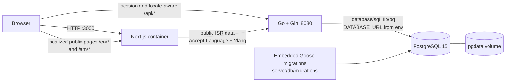
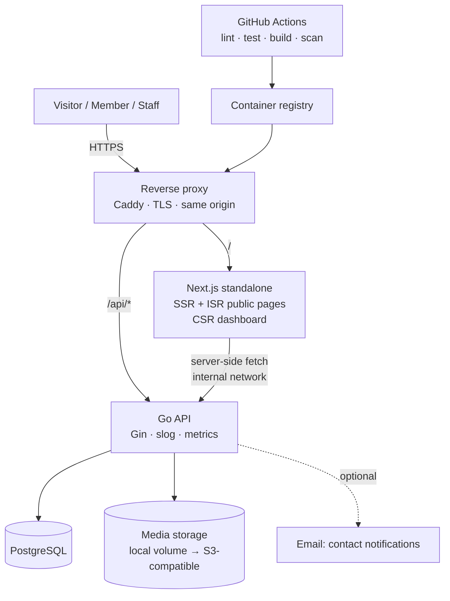
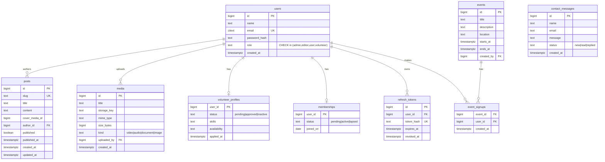

# ARCHITECTURE.md

Two views: **Current** (what the code does today) and **Target** (what the roadmap builds). The project is a community NGO site and staff workspace. Agents must keep this file in sync with the code.

## Runtime configuration

The process loads and validates environment settings once into `internal/config.Config` before opening the database. Invalid settings are reported together and stop startup. `TRUSTED_PROXIES` is a comma-separated list of trusted proxy CIDRs or addresses. The binary defaults to no trusted proxies; Compose pins its private default network to `172.21.0.0/24` and trusts that CIDR.

| Setting | Default / validation | Purpose |
|---|---|---|
| `PORT` | `8080`; 1�65535 | HTTP listen port |
| `APP_ENV` | `development` | Cookie and Gin mode; `production` enables release mode |
| `DATABASE_URL` | required | PostgreSQL connection string |
| `JWT_SECRET` | required; at least 32 bytes | Signs access tokens |
| `CORS_ORIGINS` | empty | Comma-separated allowed origins |
| `UPLOAD_DIR` | `/data/uploads` | Uploaded media storage |
| `MEDIA_MAX_MB` | `50`; positive integer | Maximum uploaded media size |
| `DB_CONNECT_RETRIES` | `8`; positive integer | Database connection retry count |
| `MIGRATE_ON_START` | `false` in the binary; Compose sets `true` | Apply embedded migrations before serving |
| `ADMIN_EMAIL`, `ADMIN_PASSWORD` | both optional; set together, password at least 12 characters | First-admin bootstrap |
| `TRUSTED_PROXIES` | empty in the binary; Compose defaults to `172.21.0.0/24` | Explicit Gin trusted proxy CIDRs or addresses |

The HTTP server uses bounded read/write/idle timeouts and graceful SIGINT/SIGTERM shutdown. `/healthz` is liveness and does not query PostgreSQL; `/readyz` and the `/health` alias check PostgreSQL with a two-second deadline. The container healthchecks use `/readyz`.

## HTTP logging, errors, and request limits

The API configures `log/slog` with a text handler in development and JSON in production. Gin uses `gin.New()` with middleware ordered as request ID, access log, panic recovery, then request body limit. Request IDs accept only `^[A-Za-z0-9-]{8,64}$`; invalid or absent IDs are replaced and returned in `X-Request-ID`. Access records include request ID, method, route pattern, status, latency in milliseconds, and authenticated user ID when available. Request bodies, cookies, authorization headers, passwords, and tokens are never logged; panic values are intentionally omitted.

All API errors use `{"error":{"code":"...","message":"...","details":{}}}`. Stable codes are `invalid_json`, `validation_failed`, `unauthorized`, `forbidden`, `not_found`, `conflict`, `rate_limited`, `payload_too_large`, and `internal`. Unexpected failures are logged with the request ID and return a generic message. The default request body limit is 1 MiB; media upload routes allow the configured file limit plus 1 MiB for multipart framing. The frontend API client extracts the nested message, safely handles non-JSON proxy errors, applies a 15-second request timeout (120 seconds for uploads), and signals session expiry on protected-route 401 responses.

Access JWTs use a typed claim structure and accept only HS256. Parsing requires issuer, issue time, expiry, positive user ID, and a recognized role; malformed claims return unauthorized. Session cookies are `HttpOnly; SameSite=Lax` in every environment and `Secure` except in development. For POST, PUT, PATCH, and DELETE requests carrying an access or refresh cookie, the API requires an allowed `Origin`, or an allowed `Referer` when `Origin` is absent. Login, registration, and contact are exempt because they do not read or rely on an existing session. Login attempts use a fixed-window key of trusted client IP plus lowercased email; register and contact use client IP. Rejections include `Retry-After`. The in-memory limiter sweeps expired entries at most every 30 seconds and caps its map at 10,000 keys.

## 1. Current state



### Current API (all under `/api`)

| Method | Path | Auth | Notes |
|--------|------|------|-------|
| POST | `/register` | none | role forced to `user`; validates name, email, password |
| POST | `/login` | none | sets access + refresh cookies; access 15 min, refresh 7 d |
| POST | `/refresh` · `/logout` | refresh cookie / none | rotates or revokes refresh session |
| POST | `/contact` | none | validates and stores a new message; IP limited |
| GET | `/staff/contact-messages?status&page&limit` | admin/editor | filtered newest-first inbox; paginated; invalid status returns 422; handler is returned by name only |
| PATCH | `/staff/contact-messages/{id}` | admin/editor | sets status to read/replied and handler from the authenticated token; missing IDs return 404; no delete route |
| GET | `/posts?page&limit&q` | none | published posts only; paginated; simple-config full-text search; newest published first |
| GET | `/posts/{slug}` | none | returns a published post; drafts return 404 |
| GET | `/media?kind&page&limit` | none | filtered, paginated media; returns `{items,page,limit,total}` |
| GET | `/events?upcoming&page&limit` | none | paginated; upcoming sorts ascending, otherwise newest first |
| GET | `/events/{id}` | none | returns an event by ID |
| GET/POST/PATCH/DELETE | `/staff/posts` · `/staff/events` | admin/editor | staff content CRUD and publish controls |
| GET/POST/DELETE | `/staff/media` | admin/editor | list, upload, delete |
| GET/POST/PATCH/DELETE | `/admin/users` | admin | user CRUD |

| GET · POST | `/admin/volunteers` · `/admin/volunteers/{id}/contributions` | admin | list volunteers and add contributions |
| GET | `/admin/volunteer-applications?status&page&limit` | admin | filtered, newest-first paginated applications; applicant name/email only |
| PATCH | `/admin/volunteer-applications/{id}` | admin | reviews pending applications once; repeats return 409; reviewer comes from the session; approval promotes only a current `user` account in the same transaction |
| GET | `/admin/events/{id}/signups?page&limit` | admin | paginated attendee names and emails |
| POST/GET | `/me/volunteer-application` | any authenticated account | submit once as a `user`, or read own application; declined applications remain and cannot be reapplied until admin action |
| GET | `/me/signups?page&limit` | any authenticated account | own event sign-ups in the standard page envelope |
| POST/DELETE | `/events/{id}/signup` | any authenticated account | sign up for a future event or cancel; duplicate signup returns 409, past event returns 422 |
| GET | `/me` · `/profile` | any user | authenticated profile reads |
| PUT | `/profile` | any user | updates name/email and optionally password |
| GET | `/healthz` | none | liveness; no database call |
| GET | `/readyz` · `/health` | none | readiness; checks database connectivity |

Auth, refresh-token, profile, admin user, post, event, media, contact, and volunteer handlers use generated sqlc queries with request contexts and injected dependencies. Media is stored through a local-disk Storage interface using random content-derived extensions and atomic temporary-file renames; uploads are sniffed against the png/jpeg/webp/pdf/mp4/webm/mp3/ogg allowlist. `/uploads/*` sets nosniff, a restrictive CSP, immutable caching, and serves byte ranges without exposing directory listings. Media rows store a checked kind backfilled from existing media_type values. Handler and middleware database access no longer uses package-level database globals. Post and event public/staff lists use `{items,page,limit,total}` pagination (default 10, maximum 50). Post search uses the `simple` text-search configuration and a GIN index. Admin volunteer contribution recording remains under `/admin/volunteers`; applications use a separate review workflow, and event sign-ups are stored separately from volunteer status.

The staff dashboard post and event modals edit English and Amharic translations from staff list responses and submit the OpenAPI `translations` request shapes. Locale changes are sent one at a time because update handlers accept one locale per request; at least one complete translation must remain. Media uploads submit a JSON `translations` multipart field with one or both language titles. The Playwright content smoke runs against the Compose stack with an environment-bootstrapped admin account.

The public frontend uses next-intl under `app/[locale]`, with `en` and `am`, `localePrefix: "always"`, and a `lang` cookie. Next.js 16 uses `proxy.ts` for locale detection; the first unprefixed visit uses the cookie or `Accept-Language` before redirecting to a prefixed URL. Public page entry points are Server Components with 60-second ISR, locale-aware API requests, canonical URLs, and hreflang alternates. Missing content translations display the API fallback note. Amharic dates use the shared `am-ET-u-ca-ethiopic` locale constant. Interface catalogs live in `front-end/messages/en.json` and `am.json`; drafted Amharic is recorded in `docs/i18n-review.md` for native review.

### Current data model

`users(id, name, email, password, role, created_at, updated_at)` with a unique lower(email) index; `posts(id, slug UNIQUE, title, content, author_id->users, published, published_at, cover_media_id->media ON DELETE SET NULL, search_vector GIN, created_at, updated_at)`; `events(id, title, description, event_date, ends_at nullable and after event_date, location, created_at)`; `media(id, title, file_path, media_type, kind CHECK image|video|audio|document with kind/created_at index, original_name, size_bytes, uploaded_by->users, created_at)`; `contact_messages(id, name, email, message, status CHECK new|read|replied, handled_by->users ON DELETE SET NULL, handled_at, created_at; status/created_at index)`; `volunteer_applications(id, user_id UNIQUE->users ON DELETE CASCADE, skills, availability, message, status CHECK pending|approved|declined, reviewed_by->users ON DELETE SET NULL, reviewed_at, created_at)`; `event_signups(event_id->events ON DELETE CASCADE, user_id->users ON DELETE CASCADE, created_at; composite primary key)`; `refresh_tokens(id, user_id, token_hash, expires_at, revoked_at)`; `volunteer_contributions(...)`

### Migration and sqlc workflow

- The canonical Goose SQL migrations live in `server/db/migrations/`; `server/db/migrations_embed.go` embeds them into the API binary. The migration directory contains SQL files only. Schema migrations contain no sample rows. Migration `0004_contact_messages.sql` renames `contacts` in place to preserve existing messages, then adds workflow status and handler metadata. Migration `0005_volunteer_applications_event_signups.sql` adds applications and event sign-ups. Declined applications remain stored and block reapplication until an administrator changes the status. Dev sample rows live in `server/db/seed/dev.sql` and load only through the `seed` Compose profile.
- `MIGRATE_ON_START=true` makes the API create a Goose provider and apply pending migrations before bootstrapping the admin or serving requests. The provider uses a PostgreSQL session advisory lock so concurrent API starts serialize. Development Compose sets this to true by default; set it explicitly in `.env` for other environments.
- Tool versions are pinned in `server/go.mod` using Go's `tool` directive: `go tool sqlc` v1.29.0 and `go tool goose` v3.24.3. Generate with `make sqlc`; enforce generated-code parity with `make sqlc-check` (`go tool sqlc diff`).
- `sqlc.yaml` reads schema from `server/db/migrations` and query sources from `server/db/query`. Generated code is committed under `server/dbgen`. All handler and middleware queries use the existing injected `*dbgen.Queries`; handlers use `*sql.DB` only where transactions are needed. Refresh rotation uses `WithTx` and locks the active token row with `SELECT ... FOR UPDATE`. PostgreSQL NUMERIC volunteer hours are generated as strings by sqlc; handlers pass decimal text to writes and convert the aggregate to the existing numeric JSON field.
- `DATABASE_URL_TEST` enables real-Postgres integration tests. Tests create an isolated temporary schema and cover migration up/down/up, BootstrapAdmin idempotence, auth/user/session flows including concurrent refresh, duplicate emails, admin guards, and role re-checks, post/event behavior including draft visibility, author ownership, role authorization, missing IDs, and event validation, B3 behavior including contact rate limiting and new-status storage, media/file cleanup, volunteer NUMERIC hours, and route-role authorization; contact inbox behavior covers migration row preservation, status ownership/filtering, pagination, invalid status, missing IDs, and route-role authorization. They skip when the variable is unset.

## 2. Target architecture



**Why a same-origin reverse proxy:** the browser calls `/api/...` on the same host, so there is no CORS in production, cookies work with `SameSite=Lax`, and `NEXT_PUBLIC_API_URL` stops being environment-specific (the build-time/runtime trap in AUDIT F4). Server-side Next code talks to `http://api:8080` on the private network.

### Go service layout (target)

```
server/
├── cmd/api/main.go            # wiring only
└── internal/
    ├── config/                # env → typed Config; fails fast
    ├── httpx/                 # router, middleware (auth, roles, ratelimit, requestid, cors, logging), error helpers
    ├── auth/                  # login, register, refresh, password, token
    ├── posts/ events/ media/ users/ volunteers/ members/ contact/   # handler + service + repository per feature
    └── db/                    # migrations_embed.go; migrations and query directories
        ├── migrations/0001_init.sql
        └── query/users.sql
```

Feature-folder layout keeps each domain self-contained and testable; repositories are interfaces so handlers can be unit-tested without Postgres.

### Auth design (target)

1. `POST /api/login` verifies bcrypt and issues an access JWT (15 min) and refresh token (7 d, random, hashed in DB) as `HttpOnly; SameSite=Lax` cookies; `Secure` is enabled outside development.
2. `POST /api/refresh` rotates the refresh token; `POST /api/logout` revokes it.
3. Auth middleware validates the access JWT and reads the current role from PostgreSQL on every request, so demotions apply immediately.
4. Mutating requests carrying a session cookie require an allowed `Origin`, or an allowed `Referer` fallback. Login, registration, and contact are exempt because they do not rely on a session.
5. Rate limits: login 10/minute per trusted client IP and lowercased email; registration and contact 10/minute and 30/minute per IP respectively. `Retry-After` is returned on throttling.
6. First admin is created from `ADMIN_EMAIL` / `ADMIN_PASSWORD` env on first boot only if no admin exists.

Roles → permissions:

| Capability | guest | user | volunteer | editor | admin |
|------------|:----:|:----:|:---------:|:------:|:-----:|
| Read published posts/events/media | ✓ | ✓ | ✓ | ✓ | ✓ |
| Contact form | ✓ | ✓ | ✓ | ✓ | ✓ |
| Edit own profile | | ✓ | ✓ | ✓ | ✓ |
| Apply as volunteer / sign up to events | | ✓ | ✓ | | |
| CRUD posts, events, media | | | | ✓ | ✓ |
| Read contact inbox | | | | ✓ | ✓ |
| Manage users, roles, volunteers, members | | | | | ✓ |

### Target data model



Content text lives in `post_translations`, `event_translations`, and `media_translations` for `en` and `am`; slugs, event dates, publication state, media paths, and other language-neutral fields stay on base rows. Migration 0006 backfills existing text as English and maintains a GIN-indexed `post_search` vector across translations. Migration 0007 removes legacy text columns after application queries use the translation tables. Public reads accept `?lang`, then `Accept-Language`, default to English, and report `language` and `fallback`; staff list reads include available translations. Staff writes send a `translations` map, and updates change one locale at a time. Handler messages use the internal English/Amharic catalog; drafted Amharic text is listed in `docs/i18n-review.md` for native review.

### Target API (v1, all under `/api/v1`, documented in `docs/openapi.yaml`)

| Area | Endpoints |
|------|-----------|
| Auth | `POST /auth/register` `POST /auth/login` `POST /auth/refresh` `POST /auth/logout` `GET /auth/me` |
| Public content | `GET /posts?page&limit&q` `GET /posts/{slug}` `GET /events?upcoming=true` `GET /events/{id}` `GET /media?kind=` |
| Contact | `POST /contact` |
| Member | `PATCH /me` `POST /me/volunteer-application` `POST /events/{id}/signup` `DELETE /events/{id}/signup` |
| Staff (admin, editor) | `POST/PATCH/DELETE /posts` `…/events` `…/media` (multipart upload), `GET /contact-messages?status&page&limit`, `PATCH /contact-messages/{id}` |
| Admin | `GET /users` `PATCH /users/{id}/role` `DELETE /users/{id}` `GET /volunteers` `PATCH /volunteers/{id}` `GET /memberships` |
| Ops | `GET /healthz` `GET /readyz` `GET /metrics` (internal only) |

Conventions: JSON; errors `{ "error": { "code", "message", "details?" } }`; pagination `{ items, page, limit, total }`; timestamps RFC 3339 UTC; IDs numeric; `409` on uniqueness conflicts; `422` for validation failures.

### Front-end structure (target)

```
front-end/
├── app/
│   ├── [locale]/                  # localized public and auth routes
│   ├── (dashboard)/dashboard/     # unprefixed staff workspace
│   ├── proxy.ts                   # locale detection (Next.js 16)
│   ├── sitemap.ts  robots.ts
├── components/ ui/ (design system) · layout/ · features/
├── lib/ api client · auth · i18n
└── types/ api.ts (generated)
```

Rendering rules: public page entry points = Server Components + ISR (`revalidate: 60`); interactive forms and signup controls are client components. Dashboard routes remain unprefixed and client rendered. Auth state comes from the cookie session via `/me`, never from `localStorage`.

## 3. Configuration (env)

| Var | Service | Example | Notes |
|-----|---------|---------|-------|
| `APP_ENV` | api | `development` | `production` enables release mode, secure cookies |
| `PORT` | api | `8080` | |
| `DATABASE_URL` | api | `postgres://app:***@db:5432/kalenbnakafl?sslmode=disable` | required |
| `JWT_SECRET` | api | 32+ random bytes | required; fail fast if short |
| `ACCESS_TOKEN_TTL` / `REFRESH_TOKEN_TTL` | api | `15m` / `168h` | |
| `CORS_ORIGINS` | api | `http://localhost:3000` | comma list; not needed behind proxy |
| `MIGRATE_ON_START` | api | `true` in development Compose | applies embedded Goose migrations before startup |
| `ADMIN_EMAIL` / `ADMIN_PASSWORD` | api | | first-boot bootstrap only |
| `UPLOAD_DIR` / `MEDIA_MAX_MB` | api | `/data/uploads` / `50` | local media disk root and per-upload limit |
| `SMTP_*` | api | | optional contact notifications |
| `NEXT_PUBLIC_SITE_URL` | web | `https://example.org` | SEO canonical/OG; build-time |
| `API_INTERNAL_URL` | web | `http://api:8080` | server-side fetch; runtime |
| `POSTGRES_USER/PASSWORD/DB` | db | | from `.env`, never defaults in prod |

## 4. Architecture decision records (index)

Keep one file per decision in `docs/adr/NNNN-title.md` (Context · Decision · Consequences). Seed list:

- **ADR-001** Monorepo with separate `front-end` and `server` services.
- **ADR-002** Same-origin reverse proxy instead of cross-origin browser→API calls.
- **ADR-003** `database/sql` + repository layer now; `pgx/v5` migration considered (lib/pq is maintenance-only).
- **ADR-004** httpOnly cookie sessions (short JWT + rotating refresh) instead of `localStorage` tokens.
- **ADR-005** Embedded Goose SQL migrations, applied before serving when `MIGRATE_ON_START=true` and serialized with PostgreSQL session advisory locking.
- **ADR-006** Local-volume media storage behind a `Storage` interface; S3-compatible later.
- **ADR-007** `next-intl` for UI i18n; content translation strategy (pending).
- **ADR-008** Tailwind v4 CSS-first tokens; no JS config.
