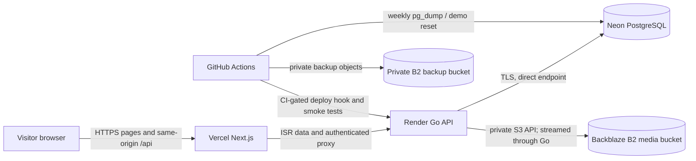

# Deployment guide

This repository can be deployed as a low-cost portfolio/demo stack. The requested free-tier combination is **not a production recommendation**: Render Free web services sleep after inactivity and can take time to resume, and Vercel Hobby is limited to personal, non-commercial use. A real NGO service with availability, privacy, or contractual obligations should use paid plans that meet those requirements.

## Architecture



Media buckets must remain private. Browsers receive media only from the API, which streams objects from B2; do not enable public bucket access or store public object URLs in content records.

## Service setup

### 1. Neon PostgreSQL

1. Create a PostgreSQL 15-compatible Neon project and production database.
2. Store the **direct** connection URL, including `sslmode=require`, as `DATABASE_URL` in Render and `NEON_DIRECT_DATABASE_URL` in GitHub Actions.
3. Do not use Neon’s `-pooler` transaction-pooling endpoint. Goose migrations use PostgreSQL session advisory locks; transaction pooling does not preserve the session state required for those locks.
4. The API defaults to at most five open and two idle connections, retires idle connections, and retries transient connection establishment and readiness pings. It retries only conservative plain `SELECT` statements outside transactions; statements containing function calls, locks, comments, or multiple statements are excluded. Writes and transactional queries are never retried because a failed response can leave the write's outcome uncertain.
5. A readiness check can briefly report unavailable while a suspended Neon compute resumes. It retries rather than permanently caching a failed state.

### 2. Backblaze B2

Create two **private** buckets: one for media and one for database backups. Use separate, least-privilege application keys for the API media bucket and backup workflow bucket. Do not reuse the media key for backups.

For the API, map B2’s S3-compatible settings as follows:

| API setting | Backblaze value |
|---|---|
| `STORAGE_DRIVER` | `s3` |
| `S3_ENDPOINT` | `https://s3.<B2-region>.backblazeb2.com` |
| `S3_REGION` | The region code shown for the bucket |
| `S3_BUCKET` | Private media bucket name |
| `S3_ACCESS_KEY_ID` | Media application key ID |
| `S3_SECRET_ACCESS_KEY` | Media application key |
| `S3_PATH_STYLE` | `true` |

Use the corresponding B2 endpoint, region, private backup bucket, and backup-only key in GitHub repository variables/secrets. Verify the key can list, upload, read, and delete only the intended bucket. Never paste key values into this repository, workflow logs, or issue comments.

### 3. Render API

1. Connect the repository to Render and create a Blueprint from [`render.yaml`](../render.yaml), or create the equivalent Docker web service manually.
2. The Blueprint uses the repository root as Docker context, `server/dockerfile`, Frankfurt, the Free plan, and `/readyz`. Render supplies `PORT`.
3. Set the required secret values in Render’s dashboard. For a live Vercel deployment, set `CORS_ORIGINS` to the exact production site origin, for example `https://project.vercel.app` (scheme and host only, no path or trailing slash).
4. Set `DATABASE_URL` to Neon’s direct TLS URL; `JWT_SECRET` to at least 32 random bytes; `ADMIN_EMAIL` and `ADMIN_PASSWORD` together for the real owner account; and the B2 media settings above.
5. Generate a separate high-entropy `FORWARDED_HEADERS_SECRET`. Set it in both Render and Vercel, and leave `TRUST_FORWARDED_HEADERS=true`. The Next.js proxy strips caller-provided forwarding headers and forwards Vercel’s platform client-IP value with this shared secret. Do not expose the secret to browser code or use it for any other purpose.
6. Keep `MIGRATE_ON_START=true` only when `DATABASE_URL` is the Neon direct endpoint. Migrations run before the service starts. For schema changes, retain the repository rule to add a new numbered Goose migration rather than editing an applied migration.

#### Service exits at startup

Open the Render service logs and check the `operation` field on the `server stopped` entry: `config`, `storage`, `database`, `migrate`, `bootstrap-admin`, or `listen` identifies the stage that failed. Configuration validation also prints a message listing invalid setting names; it does not print their values. Recheck the required Render environment variables for that stage, especially that `DATABASE_URL` uses Neon’s direct endpoint and `S3_ENDPOINT` includes `https://`. For storage or database failures, verify the bucket/key permissions and connection settings in their provider dashboards. Never paste secrets into support requests; rotate any credential that has been exposed.

Render Free is a single sleeping web service with no production availability guarantee. The GitHub keepalive workflow is best effort, not an uptime guarantee or a substitute for a paid plan.

### 4. Vercel frontend

Create a Vercel project connected to this repository with:

| Setting | Value |
|---|---|
| Root Directory | `front-end` |
| Framework preset | Next.js |
| `API_INTERNAL_URL` | `https://<render-service>.onrender.com` |
| `NEXT_PUBLIC_API_URL` | `/api` |
| `TRUST_FORWARDED_HEADERS` | `true` |
| `FORWARDED_HEADERS_SECRET` | The same secret configured on Render |

Set the API URL for both build and runtime environments. The server-side API proxy reads `API_INTERNAL_URL` at request time; public ISR fetches also use the configured origin. HTTPS Render origins are supported. `NEXT_PUBLIC_API_URL` is intentionally same-origin and is compiled into the browser bundle.

The browser calls `https://<site>/api/...`; Next.js proxies the request and response to Render. Cookies and the browser `Origin` remain on the Vercel site origin, and `Set-Cookie` returns to that same origin. Thus cookies do not need cross-site `SameSite=None` settings. The API’s write-origin check must include the exact Vercel production origin in `CORS_ORIGINS`, and `APP_ENV=production` sets the `Secure` cookie flag. Configure preview origins separately if protected write flows must work on previews; do not allow every origin.

Vercel Hobby is for personal, non-commercial projects. Confirm the plan is permitted for the project’s actual use before deploying. For commercial or organizational service, use an eligible plan.

## CI deployment, keepalive, and demo reset

The `Production deployment` workflow runs the reusable backend and frontend verification workflows on pushes to `main`. Only after both succeed does it call the Render deploy hook and poll the live API/site at `/healthz`, `/en`, `/am`, and `/api/posts`.

Configure these GitHub repository variables:

| Variable | Purpose |
|---|---|
| `RENDER_API_URL` | Render origin, e.g. `https://<render-service>.onrender.com` |
| `VERCEL_BASE_URL` | Production site origin, e.g. `https://<project>.vercel.app` |
| `B2_ENDPOINT` | B2 S3 endpoint for the selected region |
| `B2_REGION` | B2 bucket region |
| `B2_MEDIA_BUCKET` | Private media bucket |
| `B2_BACKUP_BUCKET` | Private backup bucket |
| `DEMO_EDITOR_EMAIL` | Email for the demo editor account |
| `DEMO_VOLUNTEER_EMAIL` | Email for the demo volunteer account |

Configure these GitHub Actions secrets:

| Secret | Purpose |
|---|---|
| `RENDER_DEPLOY_HOOK_URL` | Render deploy hook URL |
| `NEON_DIRECT_DATABASE_URL` | Neon direct TLS connection URL |
| `B2_MEDIA_ACCESS_KEY_ID`, `B2_MEDIA_SECRET_ACCESS_KEY` | Media-bucket application key |
| `B2_BACKUP_ACCESS_KEY_ID`, `B2_BACKUP_SECRET_ACCESS_KEY` | Backup-bucket application key |
| `DEMO_EDITOR_PASSWORD`, `DEMO_VOLUNTEER_PASSWORD` | Strong demo account passwords |
| `DEMO_SEED_EPHEMERAL_JWT_SECRET` | Optional seed-command-only random JWT secret; otherwise generated for that run |

The API’s real admin credentials are set only in Render and are not created by the demo seeder. The `seed-demo` command creates or updates only one editor and one volunteer, bilingual demo posts/events, and generated demo media. The weekly reset re-applies that content and account credentials; it does not create an admin. Demo credentials are injected at runtime from GitHub variables/secrets and must be shared with authorized testers through a private channel, not committed to README or source.

The API keepalive workflow runs every ten minutes. GitHub scheduled workflows can be delayed, skipped, or disabled during inactivity; the ping only reduces cold starts opportunistically.

The weekly database backup workflow runs `pg_dump` against Neon’s direct endpoint, uploads a custom-format dump to the private B2 backup bucket, and retains the eight newest backups. Verify scheduled workflow status and B2 object timestamps regularly; a green workflow alone is not a restore test.

## Backup restore drill

At least quarterly, restore the newest backup into a **separate disposable Neon database/branch**, not over the live database:

```sh
pg_restore --no-owner --no-acl --dbname="$RESTORE_DATABASE_URL" backup.dump
```

Then verify Goose migration state, representative English and Amharic posts/events, user roles, and application startup/readiness against that restored database. Record the backup timestamp, restore duration, and findings without recording database URLs or credentials. Delete the disposable branch only after the drill has been reviewed. For an actual recovery, first create a separate restore target, validate it, plan a maintenance window, and switch the Render `DATABASE_URL` only after approval. Keep the prior Neon database intact until the restored service is verified.

## Deploy, rollback, and move to a VPS

- **Deploy:** merge to `main`; confirm both CI jobs, Render deployment, and production smoke checks succeed. For manual recovery, use Render’s deployment history/deploy hook and rerun the documented smoke URLs.
- **Rollback:** use Render’s prior successful deployment and Vercel’s previous production deployment. If a database migration is involved, do not assume the previous binary can use the new schema. Follow an explicit backward-compatible migration plan; restore a backup to a separate database and validate before switching.
- **VPS later:** run the API and frontend containers on a maintained Linux host, keep PostgreSQL and B2 private, and put Caddy in front for automatic TLS. Restrict firewall ingress to SSH and HTTPS, pass the real proxy CIDR through `TRUSTED_PROXIES` only where appropriate, use a direct TLS PostgreSQL connection, and continue rotating secrets/backing up off-host. Caddy should proxy the site to Next.js; the Next.js `/api` route continues to proxy same-origin requests to the API.

## Manual account checklist

- [ ] Create and verify Render, Neon, Vercel, and Backblaze accounts and confirm plan terms fit the intended usage.
- [ ] Create the Neon database, direct connection URL, private B2 buckets, and separate least-privilege media/backup keys.
- [ ] Configure Render Blueprint secrets, owner admin credentials, and the exact Vercel origin.
- [ ] Configure Vercel root directory and production environment variables, including the shared forwarding secret.
- [ ] Configure GitHub repository variables/secrets listed above; create the Render deploy hook and `production` environment if using environment protection.
- [ ] Deploy from `main`, verify cookies are Secure and same-origin, check `/readyz` and localized pages, then run a backup restore drill.
- [ ] Provide demo editor/volunteer credentials to intended testers through an approved private channel; never create or publish demo admin credentials.
